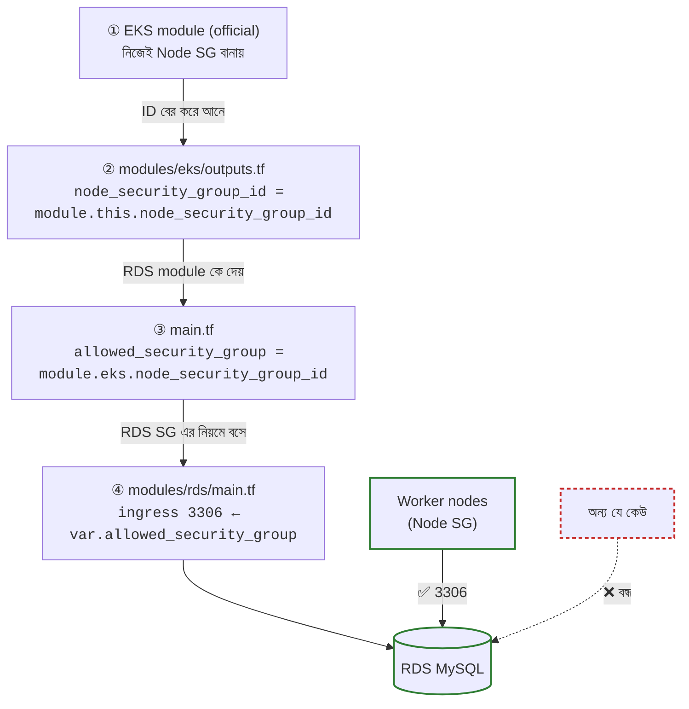

# AWS Infrastructure — EKS + ECR + RDS

এই project AWS এ তৈরি করে: **VPC → EKS → ECR → RDS (MySQL)**

## 📘 কোন environment এ কাজ করবেন?

| Environment | Guide |
|---|---|
| 🟢 **Dev** | [docs/dev.md](docs/dev.md) |
| 🔴 **Prod** | [docs/prod.md](docs/prod.md) |

> ⚠️ **নিয়ম:** `init` আর `-var-file` সবসময় একই environment এর হবে। dev এ কাজ করলে শুধু dev guide, prod এ কাজ করলে শুধু prod guide দেখবেন।

---

## Folder

```
├── main.tf               # সব module এখান থেকে call হয়
├── variables.tf          # variable এর নাম
├── environments/
│   ├── dev.tfvars        # 🟢 dev এর মান
│   ├── dev.backend.hcl   # 🟢 dev এর state
│   ├── prod.tfvars       # 🔴 prod এর মান
│   └── prod.backend.hcl  # 🔴 prod এর state
├── modules/              # vpc, eks, ecr, rds
├── bootstrap/            # state এর S3 bucket (একবারই)
└── docs/                 # dev.md, prod.md, next-steps.md
```

---

## প্রথমবার Setup (একবারই, dev/prod দুইটার জন্যই)

**লাগবে:** Terraform ≥ 1.10, AWS CLI v2, kubectl

### ১. AWS এ Terraform এর জন্য user বানানো

1. AWS Console এ ঢুকুন → উপরের search এ **IAM** লিখুন
2. **Users → Create user** চাপুন, একটা নাম দিন (যেমন `terraform-user`)
3. Permissions এ **AdministratorAccess** বেছে নিন (মানে সব কাজের অনুমতি, শুরুতে এটাই সহজ)
4. User বানানো হলে **Security credentials → Create access key** চাপুন, key দুটো কপি করে রাখুন

### ২. PC তে AWS login

```bash
aws configure                # access key, secret key, region = ap-south-1
aws sts get-caller-identity  # ঠিক হয়েছে কিনা দেখুন
```

### ৩. State bucket বানানো

```bash
cd bootstrap
terraform init
terraform apply -var="state_bucket_name=myapp-tfstate-<unique>"   # নামটা unique হতে হবে
cd ..
```

### ৪. ফাইলে নাম বসানো

- `environments/dev.backend.hcl` আর `prod.backend.hcl` এ `CHANGE-ME` এর জায়গায় bucket এর নাম দিন
- `environments/dev.tfvars` আর `prod.tfvars` এ `project = "myapp"` এর জায়গায় আপনার project এর নাম দিন

> ⚠️ যে user দিয়ে cluster বানাবেন, শুধু সে-ই `kubectl` admin হবে। তাই সবসময় একই `terraform-user` দিয়ে apply চালাবেন।

এরপর [dev](docs/dev.md) বা [prod](docs/prod.md) guide অনুযায়ী কাজ করুন।

---

## মাসিক খরচ (আনুমানিক, ap-south-1)

| Resource | 🟢 dev | 🔴 prod |
|---|---|---|
| EKS control plane (master) | $73 | $73 |
| NAT gateway + public IP | $45 (১টা) | $90 (২টা) |
| Worker node (২ × t3.medium) | $25 (Spot) | $66 (On-demand) |
| Node disk (EBS) | $4 | $4 |
| RDS MySQL + storage | $18 (micro, single-AZ) | $67 (small, Multi-AZ) |
| ECR, S3, Secrets Manager | $2 | $2 |
| **মোট** | **~$167** | **~$302** |

> Traffic এর খরচ (NAT data ~$0.056/GB) আলাদা যোগ হবে। সঠিক হিসাব [AWS Pricing Calculator](https://calculator.aws/) এ দেখে নিন।

---

## 🔐 জরুরি: Security Group

Security Group হলো AWS এর firewall, যেটা ঠিক করে **কে কোন port এ ঢুকতে পারবে**।

### এই project এ কোন কোন Security Group আছে

| Security Group | কে বানায় | কাজ |
|---|---|---|
| Cluster SG | EKS module নিজে | Master ↔ Worker node কথা বলে |
| Node SG | EKS module নিজে | Worker node রা নিজেদের মধ্যে কথা বলে |
| **RDS SG** | **আমরা** ([modules/rds/main.tf](modules/rds/main.tf)) | শুধু worker node কে database এ ঢুকতে দেয় |

> 📌 **Important Note**
> - `terraform-aws-modules/vpc/aws` module নিজেই default SG সেটআপ করে দেয়।
> - `terraform-aws-modules/eks/aws` module নিজেই node এবং cluster এর জন্য প্রয়োজনীয় SG automatically তৈরি করে। আপনাকে হাতে লিখতে হয় না।
> - হাতে লিখতে হয় শুধু **RDS SG**, কারণ database এ কে ঢুকবে সেটা আপনার সিদ্ধান্ত।

### RDS এ কে ঢুকতে পারবে

```
Worker node (Node SG)  ──✅ 3306──→  RDS
অন্য যে কেউ             ──❌──────→  RDS
```

### Chain: Node SG এর ID কীভাবে RDS পর্যন্ত যায়



> 📝 **Note — `ingress` মানে কী?**
> বাইরে থেকে **ভেতরে ঢোকার** নিয়ম, অর্থাৎ কে আর কোন port এ ঢুকতে পারবে।
> উল্টোটা হলো **`egress`**: ভেতর থেকে বাইরে যাওয়ার নিয়ম।

IP এর বদলে Security Group দিয়ে নিয়ম দেওয়া হয়েছে। তাই node বাড়লে, কমলে বা বদলে গেলেও RDS এর নিয়ম কখনো বদলাতে হয় না।

> নতুন service যোগ করলে (যেমন Redis) RDS এর মতো করেই একটা SG লিখবেন, শুধু port বদলাবে (Redis = 6379)।

---

## 🚀 পরের ধাপ (project চালু হলে, team বড় হলে)

এখন একটা admin user দিয়ে কাজ চলছে। পরে এগুলো যোগ করবেন। পুরো ধাপ আর code আছে [docs/next-steps.md](docs/next-steps.md) এ:

| # | কাজ | কেন |
|---|---|---|
| ১ | `terraform-deployer` role + MFA | Admin access key laptop এ রাখতে হবে না |
| ২ | kubectl admin এর নির্দিষ্ট list | কে apply চালাল তাতে admin বদলাবে না |
| ৩ | GitHub Actions + OIDC | PR এ নিজে `plan`, merge এ `apply`, কোনো key ছাড়া |
| ৪ | `terraform-user` এর access key মুছে ফেলা | সব শেষে, পুরোনো key এর ঝুঁকি বন্ধ |

