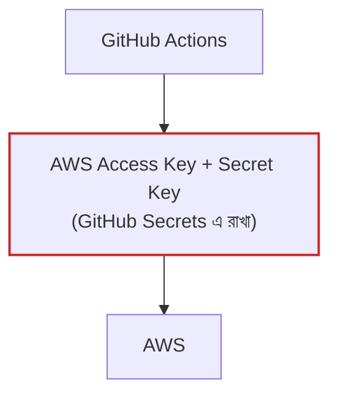
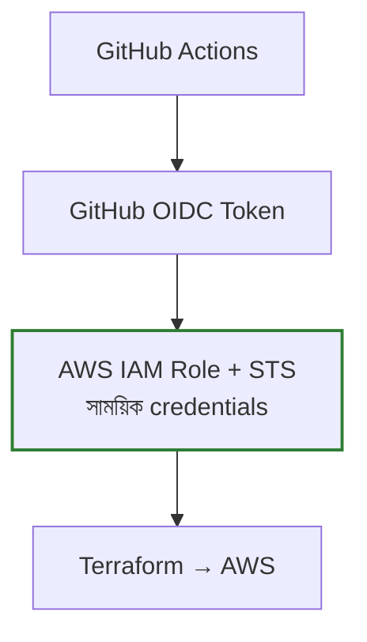

# 🚀 পরের ধাপ: Security আর Automation

এখন একটা admin user (`terraform-user`) এর access key দিয়ে কাজ চলছে। শুরুর জন্য এটা ঠিক আছে। Project চালু হলে আর team বড় হলে এই ধাপগুলো **ক্রম অনুযায়ী** করবেন।

| # | কাজ | কখন |
|---|---|---|
| ১ | [`terraform-deployer` role + MFA](#১-terraform-deployer-role--mfa) | ২ জনের বেশি মানুষ apply চালালে |
| ২ | [kubectl admin এর নির্দিষ্ট list](#২-kubectl-admin-এর-নির্দিষ্ট-list) | ধাপ ১ এর সাথেই |
| ৩ | [GitHub Actions + OIDC](#৩-github-actions--oidc) | Prod চালু হওয়ার আগে |
| ৪ | [পুরোনো access key মুছে ফেলা](#৪-পুরোনো-access-key-মুছে-ফেলা) | সব শেষে |

---

## ১. `terraform-deployer` role + MFA

**কী হবে:** সবাই একটা role দিয়ে Terraform চালাবে, আর MFA ছাড়া কেউ সেই role এ ঢুকতে পারবে না।

### ১.১ `bootstrap/main.tf` এর শেষে যোগ করুন

```hcl
data "aws_caller_identity" "current" {}

# Only IAM users of this account, signed in with MFA, can assume the role
resource "aws_iam_role" "deployer" {
  name                 = "terraform-deployer"
  max_session_duration = 7200 # 2 hours, enough for a full EKS apply

  assume_role_policy = jsonencode({
    Version = "2012-10-17"
    Statement = [{
      Effect    = "Allow"
      Principal = { AWS = "arn:aws:iam::${data.aws_caller_identity.current.account_id}:root" }
      Action    = "sts:AssumeRole"
      Condition = { Bool = { "aws:MultiFactorAuthPresent" = "true" } }
    }]
  })
}

resource "aws_iam_role_policy_attachment" "deployer_admin" {
  role       = aws_iam_role.deployer.name
  policy_arn = "arn:aws:iam::aws:policy/AdministratorAccess"
}

# Add IAM users to this group to let them assume the deployer role
resource "aws_iam_group" "deployers" {
  name = "terraform-deployers"
}

resource "aws_iam_group_policy" "deployers_assume" {
  name  = "assume-terraform-deployer"
  group = aws_iam_group.deployers.name

  policy = jsonencode({
    Version = "2012-10-17"
    Statement = [{
      Effect   = "Allow"
      Action   = "sts:AssumeRole"
      Resource = aws_iam_role.deployer.arn
    }]
  })
}

output "deployer_role_arn" {
  value = aws_iam_role.deployer.arn
}
```

তারপর:

```bash
cd bootstrap && terraform apply && cd ..
```

### ১.২ প্রতিটা team member (AWS Console এ)

1. IAM → Users → নিজের user → **MFA device যোগ করুন**
2. IAM → User groups → `terraform-deployers` → **নিজের user যোগ করুন**

### ১.৩ প্রতিটা laptop এ `~/.aws/config` এ যোগ করুন

```ini
[profile myapp-deployer]
role_arn       = arn:aws:iam::<ACCOUNT_ID>:role/terraform-deployer
mfa_serial     = arn:aws:iam::<ACCOUNT_ID>:mfa/<আপনার-mfa-device-এর-নাম>
source_profile = default
region         = ap-south-1
```

### ১.৪ এরপর থেকে প্রতিবার Terraform চালানোর আগে

```bash
eval "$(aws configure export-credentials --profile myapp-deployer --format env)"
aws sts get-caller-identity      # "assumed-role/terraform-deployer" দেখালে ঠিক আছে
```

MFA code চাইবে। Login ২ ঘণ্টা থাকে।

> README আর `docs/dev.md`, `docs/prod.md` এর শুরুতে এই login command টা যোগ করে দেবেন।

---

## ২. kubectl admin এর নির্দিষ্ট list

**সমস্যা:** এখন যে apply চালায়, সে-ই kubectl admin হয়। অন্য কেউ apply চালালে আগের জনের access চলে যায়।

**সমাধান:** admin list tfvars থেকে আসবে।

### ২.১ `modules/eks/main.tf`

এটা মুছুন:

```hcl
  enable_cluster_creator_admin_permissions = true
```

তার জায়গায় দিন:

```hcl
  # Admins come from a fixed list, not from whoever ran terraform apply
  enable_cluster_creator_admin_permissions = false

  access_entries = {
    for arn in var.cluster_admin_arns : arn => {
      principal_arn = arn
      policy_associations = {
        admin = {
          policy_arn   = "arn:aws:eks::aws:cluster-access-policy/AmazonEKSClusterAdminPolicy"
          access_scope = { type = "cluster" }
        }
      }
    }
  }
```

### ২.২ `modules/eks/variables.tf`

```hcl
variable "cluster_admin_arns" {
  description = "IAM role/user ARNs with kubectl admin access"
  type        = list(string)
}
```

### ২.৩ Root `main.tf`

`locals` এ যোগ করুন, আর `module "eks"` এ পাঠান:

```hcl
data "aws_caller_identity" "current" {}

locals {
  name = "${var.project}-${var.environment}"

  # terraform-deployer role is always a cluster admin, plus anyone in tfvars
  cluster_admin_arns = concat(
    ["arn:aws:iam::${data.aws_caller_identity.current.account_id}:role/terraform-deployer"],
    var.cluster_admin_arns,
  )
}

module "eks" {
  ...
  cluster_admin_arns = local.cluster_admin_arns
}
```

### ২.৪ Root `variables.tf`

```hcl
variable "cluster_admin_arns" {
  description = "Extra IAM role/user ARNs with kubectl admin access (terraform-deployer is always added)"
  type        = list(string)
  default     = []
}
```

### ২.৫ `dev.tfvars` / `prod.tfvars`

```hcl
cluster_admin_arns = [] # extra kubectl admins, e.g. "arn:aws:iam::123456789012:role/devops"
```

> ⚠️ এই apply টা অবশ্যই **`terraform-deployer` role দিয়ে** চালাবেন (ধাপ ১.৪)। পুরোনো `terraform-user` দিয়ে চালালে apply শেষে ওই user এর kubectl access চলে যাবে।

---

## ৩. GitHub Actions + OIDC

**কী হবে:** code push করলে GitHub নিজেই Terraform চালাবে। GitHub এ কোনো AWS key রাখতে হবে না।

### OIDC ছাড়া বনাম OIDC দিয়ে

**❌ OIDC ছাড়া**



> GitHub Secrets এ স্থায়ী AWS key রাখতে হয়। Key ফাঁস হলে যে কেউ AWS এ ঢুকতে পারবে।

**✅ OIDC দিয়ে**



> GitHub এ কোনো স্থায়ী key রাখতে হয় না। AWS শুধু অনুমোদিত workflow কে সাময়িক credentials দেয়।

### এটা কীভাবে কাজ করে

ধরুন আপনার GitHub repo হলো `my-org/aws-infrastructure`।

1. আপনি code push করলেন, GitHub Actions workflow চালু হলো।
2. GitHub একটা **OIDC token** দেয়, যেটা বলে "আমি `my-org/aws-infrastructure` repo এর workflow"।
3. AWS token টা যাচাই করে। সঠিক repo হলে IAM Role এর **সাময়িক credentials** দেয় (১ ঘণ্টার জন্য)।
4. ওই credentials দিয়ে Terraform AWS এ কাজ করে। কাজ শেষে credentials নিজেই বাতিল হয়ে যায়।

### মনে রাখার সহজ নিয়ম

| জিনিস | কাজ |
|---|---|
| **OIDC** | পরিচয় যাচাই করার ব্যবস্থা |
| **IAM Role** | অনুমতি |
| **STS** | সাময়িক credentials |
| **Terraform** | infrastructure পরিচালনা |

#### 🛠️ এবার setup শুরু

### ৩.১ `bootstrap/main.tf` এ যোগ করুন

```hcl
variable "github_repo" {
  description = "GitHub repo allowed to deploy, e.g. my-org/terraform"
  type        = string
}

resource "aws_iam_openid_connect_provider" "github" {
  url             = "https://token.actions.githubusercontent.com"
  client_id_list  = ["sts.amazonaws.com"]
  thumbprint_list = ["6938fd4d98bab03faadb97b34396831e3780aea1"]
}

# Only this repo (PRs and main branch) can assume the role
resource "aws_iam_role" "github_actions" {
  name = "github-actions-terraform"

  assume_role_policy = jsonencode({
    Version = "2012-10-17"
    Statement = [{
      Effect    = "Allow"
      Principal = { Federated = aws_iam_openid_connect_provider.github.arn }
      Action    = "sts:AssumeRoleWithWebIdentity"
      Condition = {
        StringEquals = { "token.actions.githubusercontent.com:aud" = "sts.amazonaws.com" }
        StringLike = {
          "token.actions.githubusercontent.com:sub" = [
            "repo:${var.github_repo}:ref:refs/heads/main",
            "repo:${var.github_repo}:pull_request",
          ]
        }
      }
    }]
  })
}

resource "aws_iam_role_policy_attachment" "github_actions_admin" {
  role       = aws_iam_role.github_actions.name
  policy_arn = "arn:aws:iam::aws:policy/AdministratorAccess"
}

output "github_actions_role_arn" {
  value = aws_iam_role.github_actions.arn
}
```

```bash
cd bootstrap && terraform apply -var="github_repo=my-org/terraform" && cd ..
```

### ৩.২ kubectl admin list এ GitHub role যোগ করুন

GitHub থেকে apply হলে cluster ও GitHub role ই চালাবে। তাই ধাপ ২.৩ এর `concat` list এ যোগ করুন:

```hcl
"arn:aws:iam::${data.aws_caller_identity.current.account_id}:role/github-actions-terraform",
```

### ৩.৩ `.github/workflows/terraform.yml`

```yaml
name: terraform

on:
  pull_request:
  push:
    branches: [main]

permissions:
  id-token: write      # OIDC token
  contents: read
  pull-requests: write

jobs:
  dev:
    runs-on: ubuntu-latest
    steps:
      - uses: actions/checkout@v4

      - uses: aws-actions/configure-aws-credentials@v4
        with:
          role-to-assume: arn:aws:iam::<ACCOUNT_ID>:role/github-actions-terraform
          aws-region: ap-south-1

      - uses: hashicorp/setup-terraform@v3

      - run: terraform init -backend-config=environments/dev.backend.hcl
      - run: terraform fmt -check -recursive
      - run: terraform validate
      - run: terraform plan -var-file=environments/dev.tfvars -out=tfplan

      - if: github.ref == 'refs/heads/main' && github.event_name == 'push'
        run: terraform apply tfplan
```

> Prod এর জন্য একই রকম আলাদা job বানাবেন, `environment: production` দিয়ে। GitHub → Settings → Environments এ **Required reviewers** চালু করলে prod apply এর আগে কেউ approve করতে হবে।

### ৩.৪ নিয়ম

- এরপর থেকে **কেউ laptop থেকে apply চালাবে না**। সব change PR দিয়ে যাবে।
- Laptop থেকে শুধু `plan` চালানো যাবে, দেখার জন্য।

---

## ৪. পুরোনো access key মুছে ফেলা

ধাপ ১–৩ ঠিকমতো কাজ করছে নিশ্চিত হলে:

1. IAM → Users → `terraform-user` → Security credentials → **access key Delete**
2. সবার laptop এ `~/.aws/credentials` থেকে ওই key মুছে দিন

এরপর AWS এ ঢোকার উপায় থাকবে শুধু দুইটা: **MFA দিয়ে role**, অথবা **GitHub OIDC**। কোনো স্থায়ী admin key কোথাও থাকবে না।
